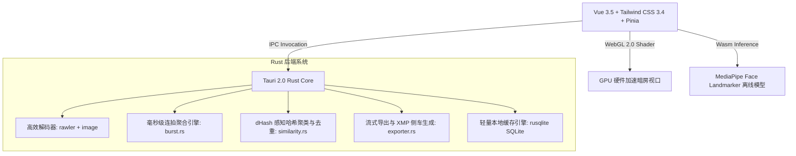

<div align="center">

# 📸 PhotoSelect Desktop

### 新一代极速摄影选片与数字资产管理平台
**Zero-Import, Millisecond RAW+JPG Darkroom & Culling Platform for Photographers**

专为商业摄影师、独立摄影师、生态鸟类摄影师与影像创作者打造的高性能桌面暗房快速初筛与管理工具。

[](https://github.com/chensiqi2007/photoselect)
[](https://v2.tauri.app/)
[](https://vuejs.org/)
[](https://www.rust-lang.org/)
[](https://www.typescriptlang.org/)
[](https://tailwindcss.com/)
[](https://www.gnu.org/licenses/agpl-3.0)
[](#)

<br/>

<a href="https://get.microsoft.com/installer/download/9mwnhgc08xkm?referrer=appbadge" target="_blank">
	
</a>

<br/>

[🌟 核心特性](#-核心特性) • [📊 软件横向对比](#-主流摄影选片工具横向对比) • [⌨️ 快捷键指南](#️-全键盘暗房盲操指南) • [📷 支持格式](#-相机-raw-格式兼容支持) • [🛠️ 技术架构](#️-技术栈与架构设计) • [🚀 快速开始](#-快速上手与编译构建) • [🤝 开源致谢](#-开源致谢与署名-acknowledgements--credits)

</div>

---

## 🌟 核心特性

### ⚡ 零导入 · 即开即看 (Zero-Import Architecture)
- **免等待直连存储卡**：彻底抛弃传统软件漫长的“拷贝文件入库”、“建立目录”与生成巨型缓存数据库的等待，直接选定相机 SD 卡、CFexpress 卷或本地硬盘文件夹，毫秒级流式读取与加载。
- **内存优化与动态回收**：基于虚拟化视口与双级 LRU 图像缓存策略，面对成千上万张 4K/8K 巨幅照片，内存占用始终恒定轻量。

### 🔗 RAW + JPG 智能同名绑定 (Smart RAW+JPG Pairing)
- **双星合一无缝汇聚**：自动将拍摄时产生的同名标准预览图（JPG/PNG）与原厂 RAW（如 `.ARW`、`.CR3`、`.NEF`、`.RAF`、`.DNG` 等）智能聚合为单一资产卡片。
- **杜绝二次重复筛选**：界面以 JPG 流畅极速呈现，后台实时联动 RAW 原片，在评级、标记或导出时实现同生共死。

### 🎨 Studio Darkroom 专业暗房设计美学
- **18% 中性灰暗房视口**：严格遵循行业标准 18% 中性灰基准底色，彻底消除环境对比对曝光判断的视觉欺骗。
- **精致玻璃拟态 (Glassmorphism)**：融合多层景深模糊、电光蓝（Electric Blue）呼吸对焦指示环与高对比度 HUD 参数平视面板。
- **摄影棚级 2×2 参数矩阵**：直观高对比度呈现光圈、快门、ISO、焦距及色彩空间。

### 🔍 High-DPI 多档等比无损缩放 (100% / 125% / 150% / 200%)
- **高分屏全界面自适应**：专为 2K、4K、5K 监视器及外接专业大屏优化，提供 `100%`、`125%`、`150%`、`200%` 四档等比无损缩放。
- **原生像素保真机制**：界面缩放仅作用于控制台面板与字体排版，WebGL 视口渲染自动对齐物理硬件像素，确保相片 100% 锐度检查时无额外双线性插值劣化。
- **快捷步进与持久记忆**：支持 `Ctrl + =` / `Ctrl + -` 步进缩放与 `Ctrl + 0` 一键复位，配置持久化保存至本地系统存储。

### ⚡ 高速连拍聚合与 Best Shot 推荐选帧
- **微秒级时间戳补偿 (SubSecTime)**：精准提取 EXIF 中的亚秒与微秒级元数据，自适应精准聚合 20–120 fps 顶级机身高频连拍序列。
- **智能评星选优算法**：综合用户标记意图、细节丰富度（羽毛与毛发纹理高频信息）与动作中心帧权重，自动推荐整组连拍中的最佳帧（Best Shot）。

### 🔍 64-bit dHash 严格去重与同主体视觉聚类
- **0.5ms 极速感知指纹**：提取轻量级缩略图生成 64-bit 感知哈希指纹，海明距离位运算毫秒级匹配。
- **机械连击去重 (Deduplication)**：自动识别机身高速连打下毫无动作位移的雷同冗余帧，支持一键批量淘汰 (Reject)。
- **同主体时序聚类 (Similarity Cluster)**：结合时间窗口与视觉结构相似度，将同一场景、同一被摄主体的照片自动聚集成组。

### ⧉「分组折叠选片」视图 (Group Folded View)
- **3D 错位层叠堆叠展示**：开启分组折叠后，整组连拍或同主体照片以 3D 阴影层次折叠为唯一代表帧，并标注组内照片总数角标，让数万张海量底片瞬间精炼为数十个决策点。
- **一键「留优汰次」极致工作流**：在分组卡片上一键执行“留优汰次”，代表最佳帧标为 `Pick (留用)`，组内其余所有过渡帧自动标记为 `Reject (淘汰)`。

### 👁️ Narrative Select 风格人眼/人脸 100% 特写检视
- **离线 MediaPipe Face Landmarker**：本地无网部署 468 关键点面部模型，极速检出画面中多个人物面部。
- **双眼 100% 焦点对焦裁切**：分别呈现左眼与右眼 100% 真实对焦点裁切小卡，计算合焦锐度百分比与闭眼/眨眼预警。
- **智能吸附联动**：点击眼部特写卡，主视口瞬间精准吸附居中放大至对应眼部焦点。

### 🎯 WebGL 2.0 硬件级着色器视口
- **原生 Shader 级峰值对焦 (Focus Peaking)**：实时以高饱和亮色勾勒高反差锐度边缘轮廓，焦点落在睫毛还是鼻尖一目了然。
- **GPU 瞬时 100% 锐度缩放**：双击或按下快捷键瞬间以鼠标光标为锚点进行 100% 真实像素无级平滑缩放与拖拽。

### ⚖️ 双图并排联动对比模式 (Compare View)
- **基准图 [A] 与候选图 [B] 左右分屏**：支持双图同屏联动比对，同步缩放、同步平移，细节分毫毕现。
- **极速双向裁决**：提供一键「留用 A · 淘汰 B」与「留用 B · 淘汰 A」，按下 `S` 键一键左右互换。

### 📦 快捷流式流转导出 & Lightroom Classic `.xmp` 双向同步
- **零阻塞多线程导出**：支持仅导出同名 RAW（看 JPG 筛选，拷走对应 RAW）、同时导出 RAW+JPG、或仅导出标准图，并支持分目录归类与重命名。
- **完整 XMP 侧车生态兼容**：自动生成符合 Adobe Lightroom Classic 标准的 `.xmp` 附属文件，完美同步星级（Rating）与旗标（Pick/Reject）。
- **层级关键字分类树**：全面支持平铺关键字 `<dc:subject>` 与多层级物种分类树 `<lr:hierarchicalSubject>`（如 `动物|鸟类|红嘴相思鸟`），支持免导出直接回写源目录同名侧车。

### 🦅 智能生态与野生鸟类识别 (规划与集成推进中)
- **鸟类主体与鸟眼关键点检测**：自动定位鸟类头部与眼睛区域，智能判定关键点合焦锐度。
- **物种智能分类 (Bird ID)**：内置离线物种分类学映射表，识别常见鸟类中英文名与学名。
- **生态元数据自动归档**：将识别到的鸟种名称与拍摄生态特征自动格式化写入 XMP 关键字。

### 🤖 AI 智能多模态视觉选片助手
- 兼容 OpenAI 格式 Vision 多模态模型接口，可批量智能评估画面构图完整度、神态表情与对焦瑕疵并提供打星打标参考建议。

### 🌐 多语言与日间/暗房双主题
- 支持简体中文、繁體中文与 English 界面，支持一键在深色暗房与浅色日间主题之间平滑切换。

---

## 📊 主流摄影选片工具横向对比

| 功能特性 / 评价维度 | 📸 **PhotoSelect Desktop** | **Adobe Lightroom Classic** | **Photo Mechanic** | **Narrative Select** |
| :--- | :---: | :---: | :---: | :---: |
| **导入等待时间** | **0 秒 (零导入即开即看)** | 较长 (需建立目录与转码预览) | 0 秒 (读取文件系统) | 较长 (需同步与构建项目) |
| **RAW+JPG 智能同名绑定** | **原生自动化聚合** | 需独立设置/易产生混乱 | 需配置显示选项 | 支持 |
| **GPU 视口与峰值对焦** | **WebGL 2.0 原生 Shader 峰值** | 无原生峰值对焦显示 | 无峰值对焦 | 无 |
| **人眼 100% 特写检视** | **集成 100% 裁切与锐度评分** | 无 (需手动逐张放大看) | 无 | 有 (主要收费卖点) |
| **连拍聚合与 Best Shot** | **EXIF 亚秒级聚合 + 选优** | 需手动叠放或连拍分组 | 仅时间间隔粗略分组 | 有 |
| **64-bit dHash 严格去重** | **支持 (0.5ms 感知哈希)** | 无 | 无 | 部分支持 |
| **「分组折叠选片」视图** | **3D 叠放卡片 + 一键留优汰次** | 常规堆叠 | 接触式展开 | 有 |
| **High-DPI 等比缩放** | **100%/125%/150%/200% 四档** | 依赖系统缩放 (有时模糊) | 传统排版界面 | 依赖系统缩放 |
| **XMP 生态与分类树同步** | **全兼容 Adobe LrC 侧车** | 原生支持 | 原生支持 | 导出同步 |
| **数据隐私与商业安全** | **100% 本地离线优先** | 本地 | 本地 | 依赖部分云端订阅 |
| **软件定价策略** | **完全免费 / 终身开源承诺** | 昂贵订阅制 | 高昂买断制 | 昂贵订阅制 |

---

## ⌨️ 全键盘暗房盲操指南

专业暗房的核心精髓在于**视线始终停留在相片主体上，手指盲打完成所有评判**。

| 操作功能 | 快捷键 | 详细说明 |
| :--- | :---: | :--- |
| **星级评定** | <kbd>0</kbd> – <kbd>5</kbd> | 分别赋予相片 0 至 5 颗星，打分后可配合自动后移 |
| **留用旗标 (Pick)** | <kbd>P</kbd> | 标记为“留用”候选片（绿色标牌），准备精修流转 |
| **淘汰旗标 (Reject)** | <kbd>X</kbd> | 标记为“淘汰”次片（红色标牌），暗化遮罩显示 |
| **清除旗标 (Unflag)** | <kbd>U</kbd> | 移除当前留用或淘汰旗标 |
| **快捷色标标记** | <kbd>6</kbd> / <kbd>7</kbd> / <kbd>8</kbd> / <kbd>9</kbd> | <kbd>6</kbd> 红 · <kbd>7</kbd> 黄 · <kbd>8</kbd> 绿 · <kbd>9</kbd> 蓝 · <kbd>0</kbd> 清除色标 |
| **前后翻页导航** | <kbd>←</kbd> <kbd>→</kbd> 或 <kbd>A</kbd> <kbd>D</kbd> | 平滑切换相邻相片，支持长按快速连刷 |
| **单张放大 100%** | <kbd>Space</kbd> 或 双击鼠标 | 以当前光标位置为中心，瞬间一键切至 100% 锐度检查 |
| **峰值对焦轮廓** | <kbd>F</kbd> | 开启/关闭硬件 GPU 峰值对焦边缘高亮，验焦极速直观 |
| **对比模式图位互换** | <kbd>S</kbd> | 在双图对比（Compare View）下快速互换 A/B 所在位置 |
| **人眼特写检视锁定** | <kbd>Z</kbd> | 展开/折叠 Narrative Select 风格人眼焦点微窗 |
| **界面与字体放大** | <kbd>Ctrl</kbd> + <kbd>+</kbd> | 页面界面与控制台字体步进缩放（100% → 125% → 150% → 200%） |
| **界面与字体缩小** | <kbd>Ctrl</kbd> + <kbd>-</kbd> | 页面界面与控制台字体步退缩放 |
| **界面缩放快速复位** | <kbd>Ctrl</kbd> + <kbd>0</kbd> | 恢复至 100% 原始标准视图尺度 |

---

## 📷 相机 RAW 格式兼容支持

依托 Rust 底层强大的解码矩阵（包括 `rawler`、`image` 以及原厂嵌入式全保真预览流提取技术），PhotoSelect 原生支持市面上各大主流机型：

| 品牌 / 系统 | 文件扩展名 | 适用代表机型 |
| :--- | :--- | :--- |
| **Sony (索尼)** | `.ARW`, `.srf`, `.sr2` | A1, A9 III, A7R V, A7 IV, A7C II, FX3 等全系列 |
| **Canon (佳能)** | `.CR3`, `.CR2` | EOS R1, R5 Mark II, R6 Mark II, R3, 5D Mark IV 等 |
| **Nikon (尼康)** | `.NEF`, `.NRW` | Z9, Z8, Z6 III, Zf, D850 等全系列 |
| **Fujifilm (富士)** | `.RAF` | GFX100 II, X-T5, X-H2S, X100VI 等 |
| **Adobe 通用** | `.DNG` | 各品牌转化 DNG、Leica (徕卡)、DJI (大疆无人机)、哈苏 |
| **Panasonic (松下)** | `.RW2` | S5 II, S1H, GH6, G9 II 等 |
| **Olympus/OM (奥之心)**| `.ORF` | OM-1 Mark II, E-M1X 等 |
| **标准位图格式** | `.JPG`, `.JPEG`, `.PNG`, `.WebP` | 所有主流数码影像输出格式 |

---

## 🛠️ 技术栈与架构设计



- **底层桌面运行时**：[Tauri 2.0](https://v2.tauri.app/) (Rust 1.78+)，极小体积、极低内存占用、无 Chromium 冗余包袱。
- **现代化前端框架**：[Vue 3.5](https://vuejs.org/) (Composition API) + [TypeScript 5.6](https://www.typescriptlang.org/) + [Vite 5.4](https://vitejs.dev/)。
- **状态流转与热键响应**：[Pinia 2.2](https://pinia.vuejs.org/)，毫秒级响应全局全键盘状态机切换。
- **图形与着色渲染**：原生 WebGL 2.0 Fragment Shader（实现峰值边缘算法与色调映射）。
- **人脸与眼部定位**：`@mediapipe/tasks-vision` + WebAssembly 本地推理。
- **并发与多线程流转**：`tokio` 异步运行时 + `rayon` CPU 数据级并行运算。

---

## 🚀 快速上手与编译构建

### 环境先决条件

| 工具环境 | 建议版本 | 说明 |
| :--- | :--- | :--- |
| **Node.js** | ≥ 18.0 (推荐 20 / 22 LTS) | 前端依赖与打包工具链 |
| **Rust** | ≥ 1.78.0 (`rustup update stable`) | Tauri 后端核心编译 |
| **C++ 构建工具** | Windows: MSVC (Visual Studio 生成工具) | 编译 C/C++ 与 Rust 原生绑定 |

### 1. 本地调试与开发

```bash
# 1. 克隆代码仓库
git clone https://github.com/chensiqi2007/photoselect.git
cd photoselect

# 2. 安装前端依赖
npm install

# 3. 启动开发模式 (同时启动 Vite 前端热重载与 Tauri 桌面端)
npm run tauri:dev

# 4. 纯前端调试模式 (浏览器预览)
npm run dev
```

### 2. 生产制品编译

```bash
# 完整前端类型验证与 Vite 生产打包
npm run build

# 编译 Windows 独立便携式可执行文件 (.exe)
.\build-exe.bat       # 或执行 PowerShell: .\build-exe.ps1

# 编译 Microsoft Store 认证的 MSIX 应用包
npm run build:msix

# 编译 Linux 发行版安装包 (原生 Debian .deb / RPM via WSL)
npm run build:linux
```

> 打包成功后，发布物将自动生成于项目根目录及 `src-tauri/target/release/` 下。

---

## 🤝 开源致谢与署名 (Acknowledgements & Credits)

本项目在生态摄影、野生鸟类识别与连拍筛选的算法思路与标准设计中，深度借鉴并致敬以下优秀的开源项目与学术成果：

- **[SuperPicky (慧眼选鸟)](https://github.com/jamesphotography/SuperPicky)** by [James Yu (jamesphotography)](https://github.com/jamesphotography)
  - 核心启发：鸟类摄影多模型协同（YOLO + 头部锐度 + 美学评价）、相机原厂对焦点空间碰撞检测、连拍毫秒级聚类算法。
  - 授权协议：[GNU AGPL-3.0 License](https://github.com/jamesphotography/SuperPicky/blob/master/LICENSE)。
- **[OSEA (Open Species Estimation for Avians)](https://github.com/sun-jiao/osea)** by [Sun Jiao (孙娇)](https://github.com/sun-jiao)
  - 核心启发：离线鸟类批量识别分类模型架构与数据处理标准。
  - 授权协议：[GNU GPL-3.0 License](https://github.com/sun-jiao/osea)。
- **[SuperBirdEye (SuperEyes)](https://github.com/triple333sR9/SuperBirdEye) & [SuperFlier](https://github.com/triple333sR9/SuperFlier)** by [Jordan Yu (于若君)](https://github.com/triple333sR9)
  - 核心启发：鸟眼/鸟头关键点精准定位与飞版姿态识别。
- **[AviList: The Global Avian Checklist](https://doi.org/10.2173/avilist.v2025)** by AviList Core Team (2025)
  - 核心启发：统一标准鸟类分类学与中英文名映射表。
  - 授权协议：[Creative Commons Attribution 4.0 International (CC BY 4.0)](https://creativecommons.org/licenses/by/4.0/)。
- **[TOPIQ](https://github.com/chaofengc/IQA-PyTorch)** by Chaofeng Chen et al.
  - 核心启发：基于自顶向下语义特征的无参考图像美学质量评估。
- **[photoselect](https://github.com/sksj200017-collab/photoselect)** by sksj200017-collab
  - 核心启发：基于感知哈希与特征匹配的照片轻量化去重、相似度聚类与组折叠交互思路。
- **[Ultralytics YOLO](https://github.com/ultralytics/ultralytics)** by Ultralytics
  - 核心启发：目标检测与分割基础设施。
  - 授权协议：[AGPL-3.0 License](https://github.com/ultralytics/ultralytics/blob/main/LICENSE) / Commercial License。

---

## ⚖️ 开源协议合规说明 (Open Source License Compliance)

为严格遵守上述开源项目所采用的 **GNU AGPL-3.0 / GPL-3.0 / CC BY 4.0** 许可证条款，本项目采取如下严密的合规与架构隔离策略：

1. **架构隔离（Clean Boundary / Loose Coupling）**：
   - 涉及 GPL/AGPL 许可的重量级模型推理（如 OSEA / SuperPicky 原生 Python 推理流水线），将作为**独立外部子进程（Sidecar Process / CLI Tool）**或**独立开放微服务**运行，通过标准 IPC / JSON-RPC 通信，绝不以静态链接或动态链接方式侵入 PhotoSelect Desktop 的核心可执行文件。
   - 所有引用 CC BY 4.0 的数据集及物种字典（如 AviList），均完整保留原始版权声明与变更说明。
2. **纯原生宽松模型路径（Native Permissive Path）**：
   - 内置离线推理优先选用 MIT / Apache-2.0 兼容的开源模型（如 ONNX 格式导出的通用检测器与自研轻量拉普拉斯梯度算法），确保分发与商业使用的绝对法律安全。
3. **衍生代码开源义务保障**：
   - 若用户选择使用包含 AGPL/GPL 代码的扩展插件包或分支，该独立扩展组件将依法完整开源并继承对应开源协议。

---

## 📄 许可证 (License)

本项目基于 **[GNU Affero General Public License v3.0 (GNU AGPL-3.0)](LICENSE)** 开放源代码。

您可以自由地使用、修改、分发及运行本项目。依据 AGPL-3.0 条款，任何基于本项目的衍生作品或通过网络提供服务的使用方式，均须在相同许可证下开放完整源代码。相关依赖库及第三方模型/数据遵循其各自的开源许可证。
